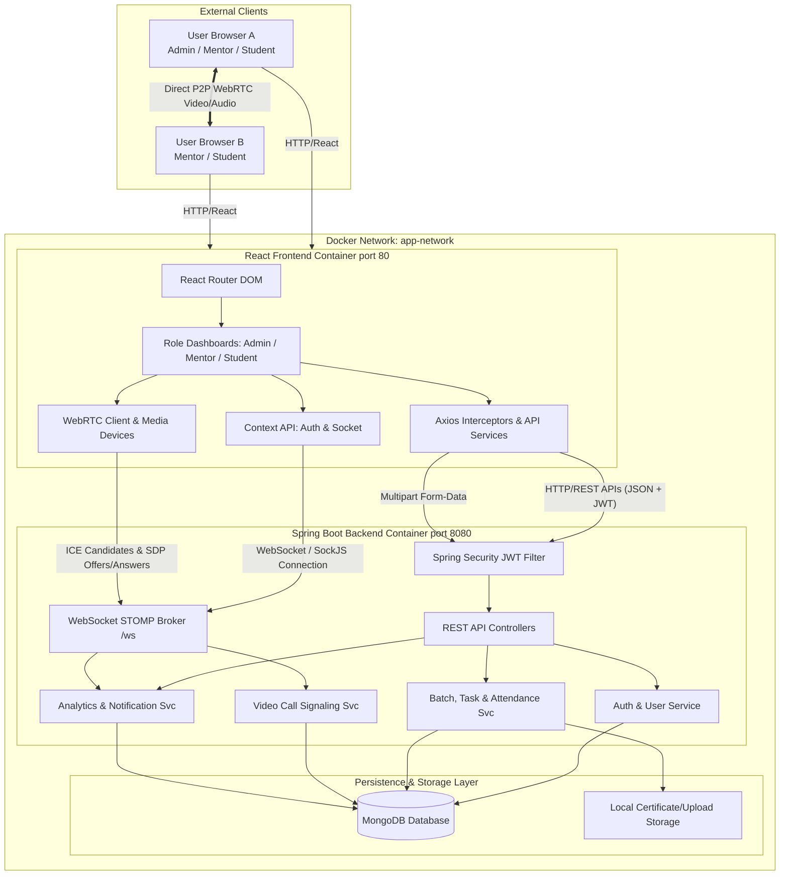
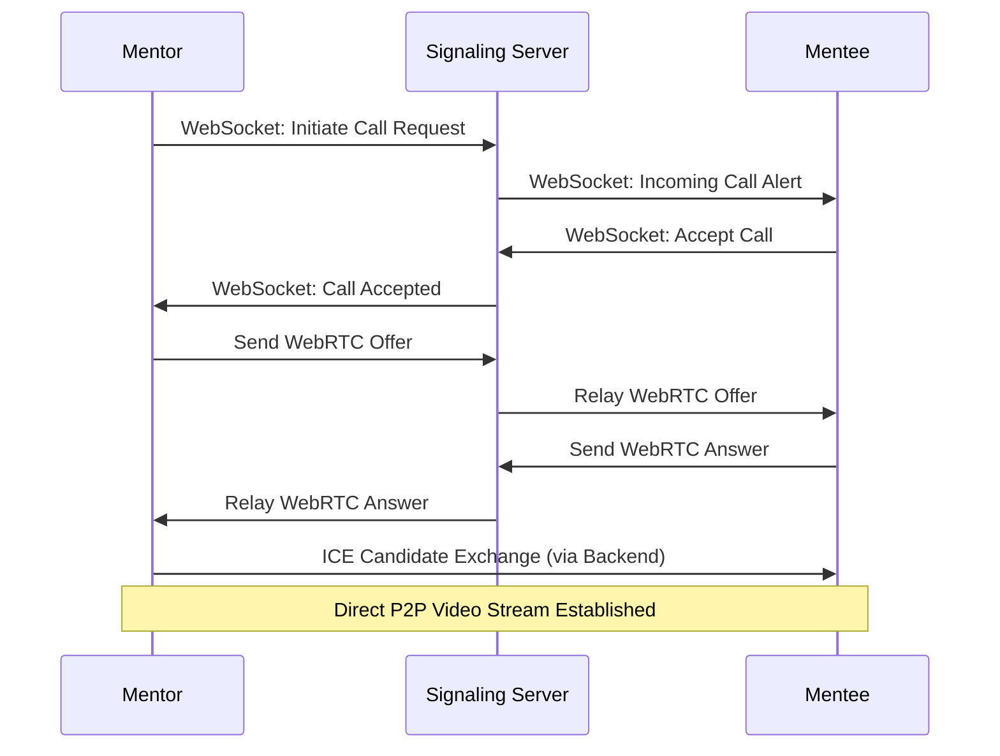

# MenteeConnect — Backend

<div align="center">
  
  
  
  
  
  
  <a href="https://menteeconnect.vercel.app/" target="_blank">
    
  </a>
</div>

<div align="center">
  <h3>Backend for Role-Based Mentor-Student Management System</h3>
  <p><em>Secure, scalable Spring Boot backend powering an academic mentorship platform with real-time video calling, JWT authentication, and role-based access control.</em></p>
  <br/>
  <strong><a href="https://menteeconnect.vercel.app/">menteeconnect.vercel.app</a></strong>
</div>

---

## Architecture Overview

MenteeConnect utilizes a decoupled, high-performance architecture combining a robust, secure Spring Boot backend with a dynamic React frontend. 



## Features

- **Role-Based JWT Authentication:** Secure login and session management for Admin, Mentor, and Student roles.
- **WebRTC Video Call Signaling:** Backend signaling server enabling low-latency peer-to-peer video calls between mentors and mentees.
- **Real-Time Notifications:** WebSocket-based incoming call alerts and announcements delivered instantly to users.
- **Meeting History APIs:** Comprehensive storage and retrieval of video call records, enabling mentors to access their own history and admins to oversee platform-wide records.
- **Comprehensive Management APIs:** Full CRUD functionality for user, batch, mentor, and student management.
- **Goal & Certificate Tracking:** Robust tracking capabilities for student assignments, goals, and achievements.
- **File Upload Support:** Secure handling of multipart form data for profile photos and educational resources.
- **Password Security:** BCrypt hashing for all user credentials to maintain high security standards.

---

## Technologies Used

| Category      | Tech Stack                              |
|---------------|------------------------------------------|
| Language      | Java 17+                                 |
| Framework     | Spring Boot 3+                           |
| Database      | MongoDB 6+ (NoSQL)                       |
| Security      | Spring Security + JWT Authentication     |
| Real-Time     | WebSocket (Spring Messaging + STOMP)     |
| Video Calls   | WebRTC Signaling via WebSocket           |
| Build Tool    | Maven                                    |
| Logging       | SLF4J + Logback                          |
| Deployment    | Docker                                   |

---

## Video Call Integration Architecture

The backend serves as a critical WebRTC signaling server, coordinating the initial handshake and peer connection setup.



**Access Control Details:**
- Mentors are strictly restricted to initiating calls with their allocated mentees.
- Call history retrieval endpoints (`/api/meetings/mentor`) are scoped to the authenticated mentor.
- System-wide meeting records are restricted to the Admin dashboard via `/api/meetings/all`.

---

## Project Structure

```text
backend/
└── src/
    └── main/
        ├── java/com/menteeconnect/
        │   ├── controllers/       # REST Controllers
        │   ├── services/          # Business Logic Layer
        │   ├── models/            # MongoDB Document Models
        │   ├── repositories/      # MongoDB Repositories
        │   ├── security/          # JWT Filters, Auth Config
        │   └── config/            # CORS, WebSocket, WebRTC Config
        └── resources/
            ├── application.yml    # App Configuration
            └── static/            # Static assets
```

---

## Configuration & Setup

### `application.yml` Example

```yaml
server:
  port: 8080

spring:
  data:
    mongodb:
      uri: ${MONGO_URI:mongodb://localhost:27017/menteeconnect}
      database: menteeconnect
  servlet:
    multipart:
      enabled: true
      max-file-size: 10MB
      max-request-size: 10MB

jwt:
  secret: ${JWT_SECRET}
  expiration: 86400000
```

*Note: Ensure all sensitive configurations (`JWT_SECRET`, `MONGO_URI`) are injected via environment variables.*

### Local Development

**Prerequisites:**
- Java 17+
- Maven 3.6+
- MongoDB 6.0+

```bash
# Navigate to the project directory
cd Mentee_Connect

# Clean and build the application
mvn clean install

# Launch the Spring Boot server
mvn spring-boot:run
```

---

## Security Implementation

- **Token Validation:** All protected API endpoints enforce JWT validation filters.
- **RBAC (Role-Based Access Control):** Granular separation of concerns for Admin, Mentor, and Student endpoints.
- **Data Protection:** BCrypt password encoding ensures data integrity at rest.
- **CORS Policies:** Configured origin validation for frontend integration safety.

---

## Deployment Configuration

**Docker Profile:**

```dockerfile
FROM openjdk:17-jdk-slim
COPY target/menteeconnect.jar app.jar
EXPOSE 8080
ENTRYPOINT ["java", "-jar", "app.jar"]
```

**Build and Run Commands:**

```bash
docker build -t menteeconnect-backend .
docker run -p 8080:8080 \
  -e JWT_SECRET=your_secret \
  -e MONGO_URI=mongodb://host.docker.internal:27017/menteeconnect \
  menteeconnect-backend
```

---

## Developer

**Mahesh Shinde**

- **Email:** [maheshshinde9100@gmail.com](mailto:maheshshinde9100@gmail.com)
- **Portfolio:** [maheshshinde-dev.vercel.app](https://maheshshinde-dev.vercel.app)
- **LinkedIn:** [linkedin.com/in/maheshshinde9100](https://www.linkedin.com/in/maheshshinde9100)
- **GitHub:** [github.com/maheshshinde9100](https://github.com/maheshshinde9100)

*MenteeConnect is part of an academic mentorship platform. All rights reserved.*
